# 🔁 SkillSwap — Teach what you know, learn what you don't

A peer-to-peer **skill exchange platform** built with the **MERN stack + Socket.io + WebRTC**.
Students list skills they can teach and skills they want to learn. A two-way matching algorithm finds perfect swaps, and users chat in real time, video call, schedule sessions, verify skills with quizzes, and rate each other.

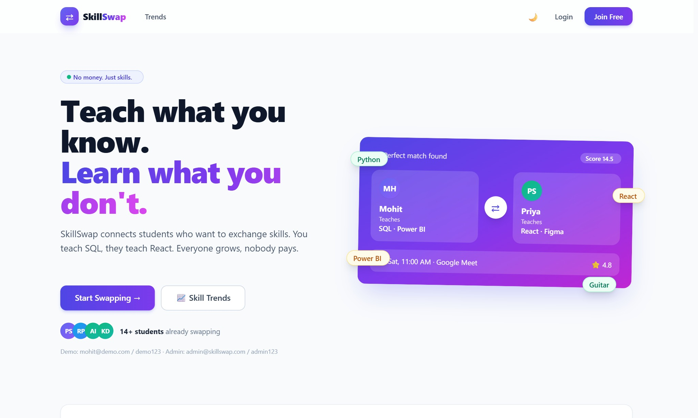

## ✨ Features

| Area | Features |
|---|---|
| 🔐 Auth | Email/password (JWT + bcrypt), **Continue with Google** (OAuth ID-token verification), role-based access (user / admin) |
| 🎯 Smart Matching | Two-way match score (they teach what you want + you teach what they want), mutual-swap bonus, rating tie-breaker |
| ⇄ Swap Requests | Send, accept, decline, with duplicate-request protection |
| 💬 Real-time Chat | Socket.io messaging, typing indicator, online presence |
| 📹 Video Call | In-app **peer-to-peer WebRTC** video calls (Socket.io signaling, STUN), mute / camera / timer |
| 📅 Sessions | Schedule with date, duration and Meet link; mark done / cancel |
| ⭐ Reviews | Rate after completed sessions; average rating auto-updates |
| 🤖 SkillBot (AI) | Learning-roadmap assistant using **Google Gemini** with user + platform context; offline fallback with built-in roadmaps |
| 🎓 Skill Quiz | 8 skill quizzes, server-side grading, shuffled options, timer; pass = **✔ Verified** skill badge |
| 🏆 Gamification | Points, 7 levels, 9 badges, leaderboard with podium |
| 📊 Personal Analytics | Monthly activity, learning hours, skills taught/learned, points breakdown, rating distribution |
| 📈 Public Trends | Most wanted / offered skills, **demand vs supply gap**, weekly swap activity |
| 🛡️ Admin | Analytics dashboard, ban/unban users, moderate reviews, **CSV export** (users, swaps, sessions, reviews) for Excel / Power BI |
| 🎨 UI | Tailwind CSS, dark mode, animations, skeleton loaders, mobile bottom navigation |

## 📸 Screenshots

| Dashboard | Explore (smart matching) |
|---|---|
| 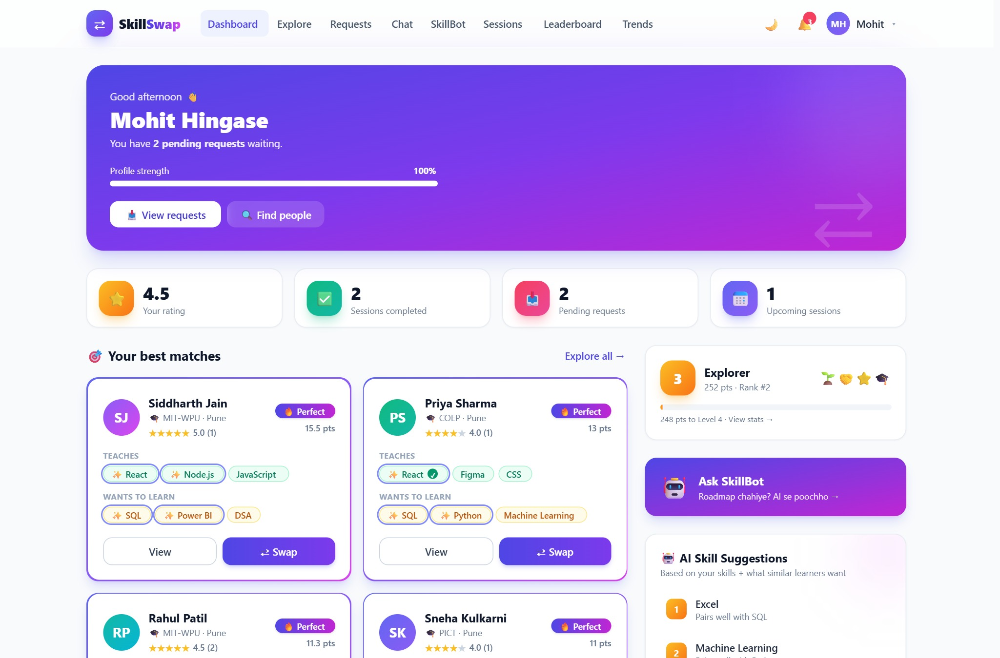 | 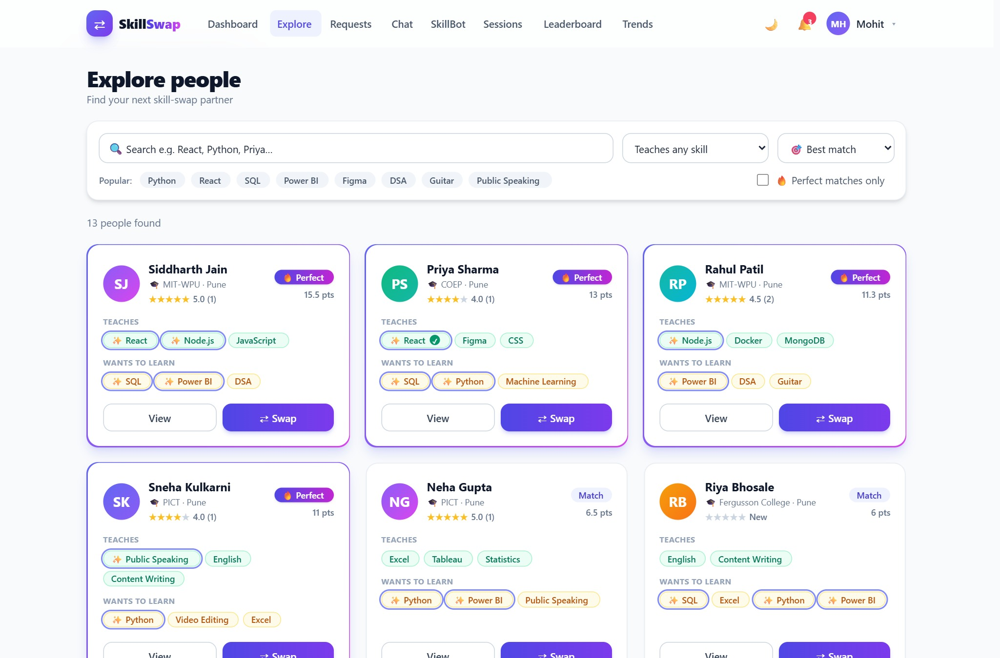 |

| Real-time Chat + Video Call | SkillBot (AI roadmap) |
|---|---|
| 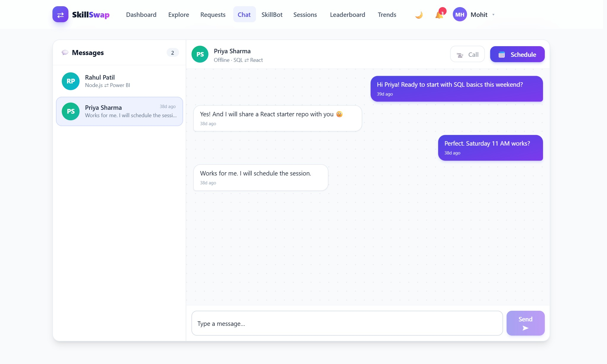 | 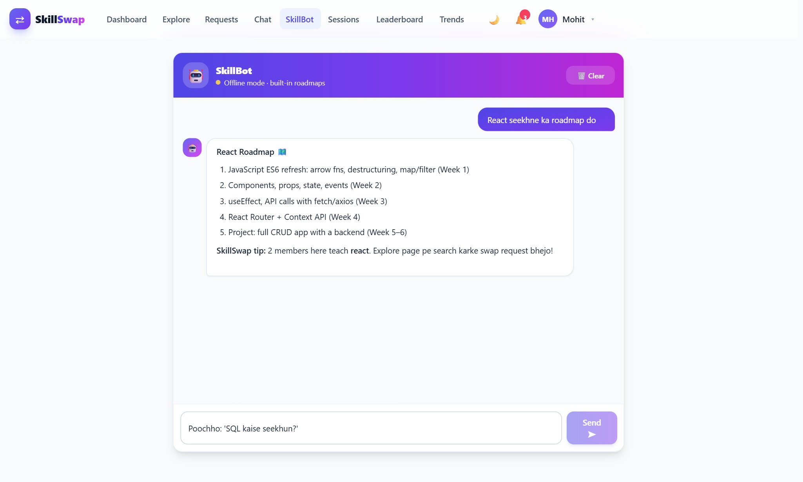 |

| Leaderboard | My Stats (badges & analytics) |
|---|---|
| 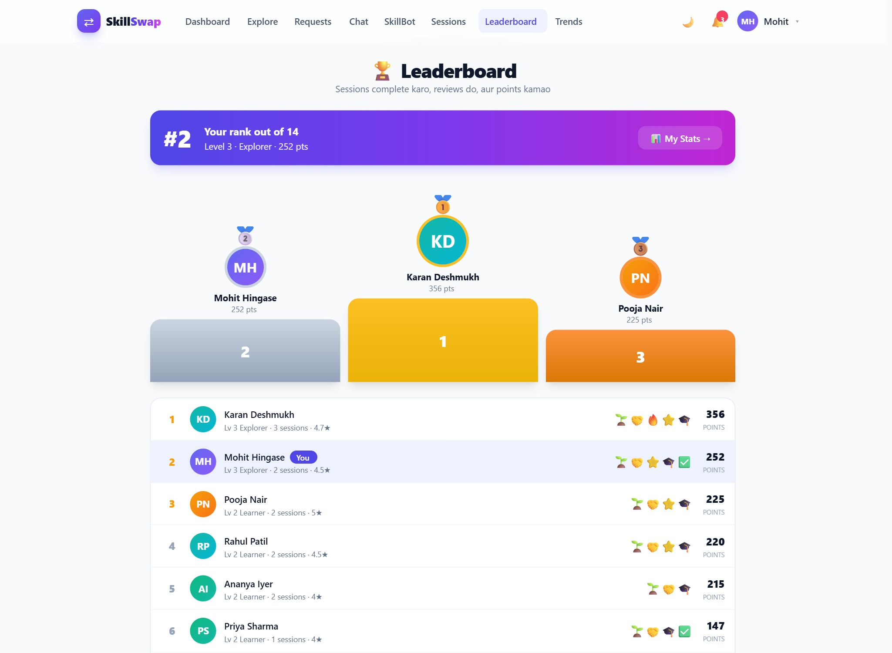 | 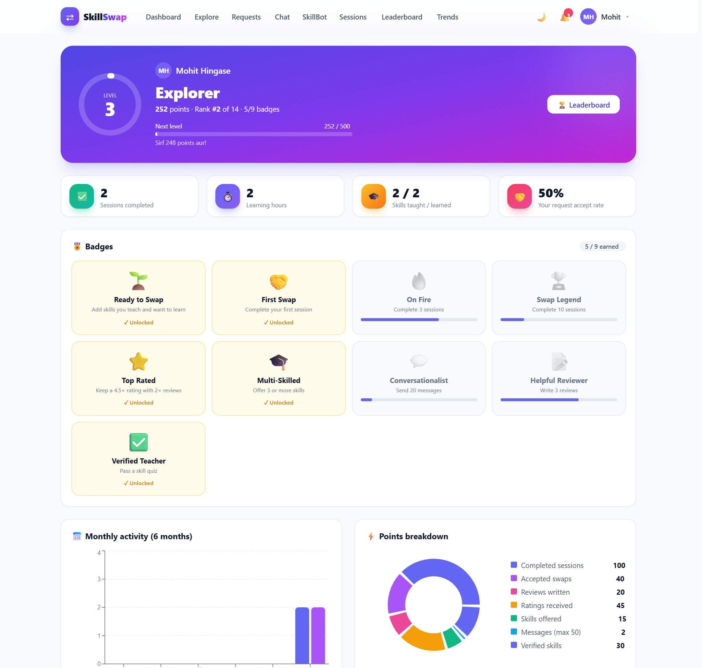 |

| Skill Verification | Quiz |
|---|---|
| 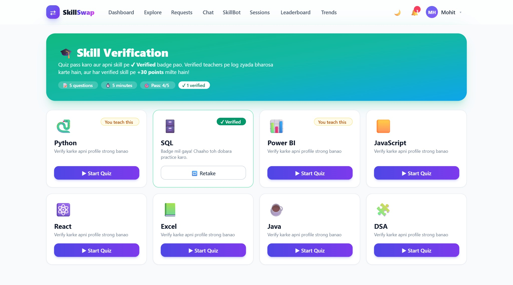 | 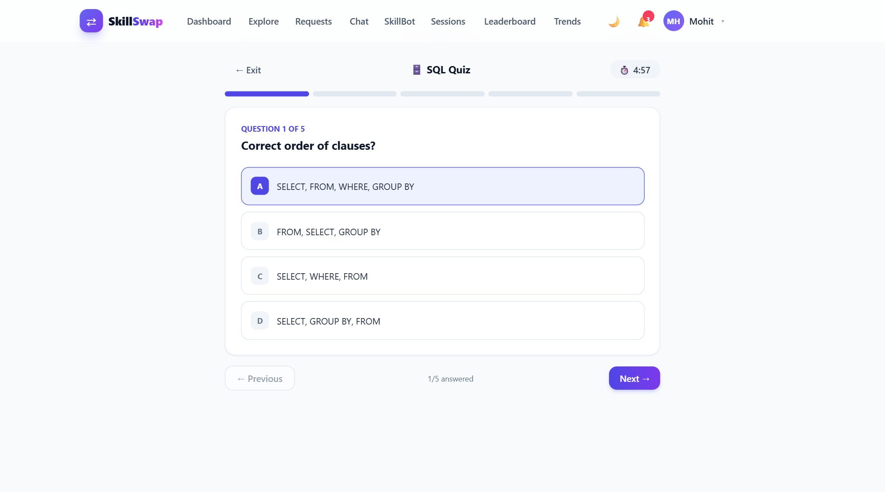 |

| Skill Demand Trends | Admin Dashboard + CSV Export |
|---|---|
| 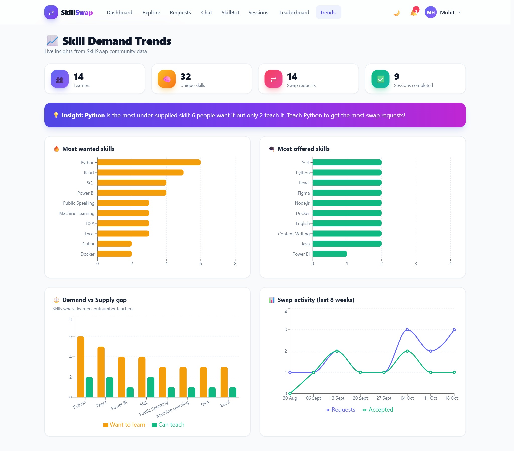 | 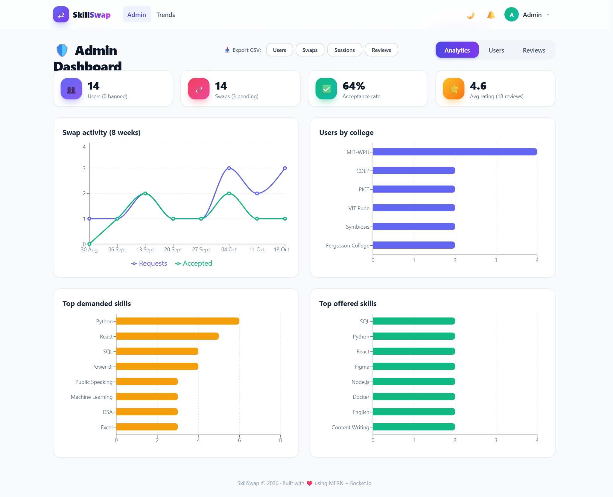 |

| Sessions | Login (Google + email) |
|---|---|
| 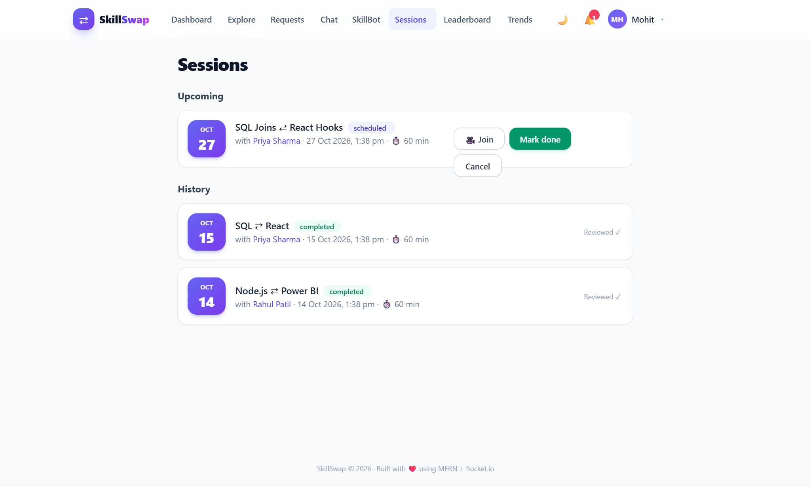 | 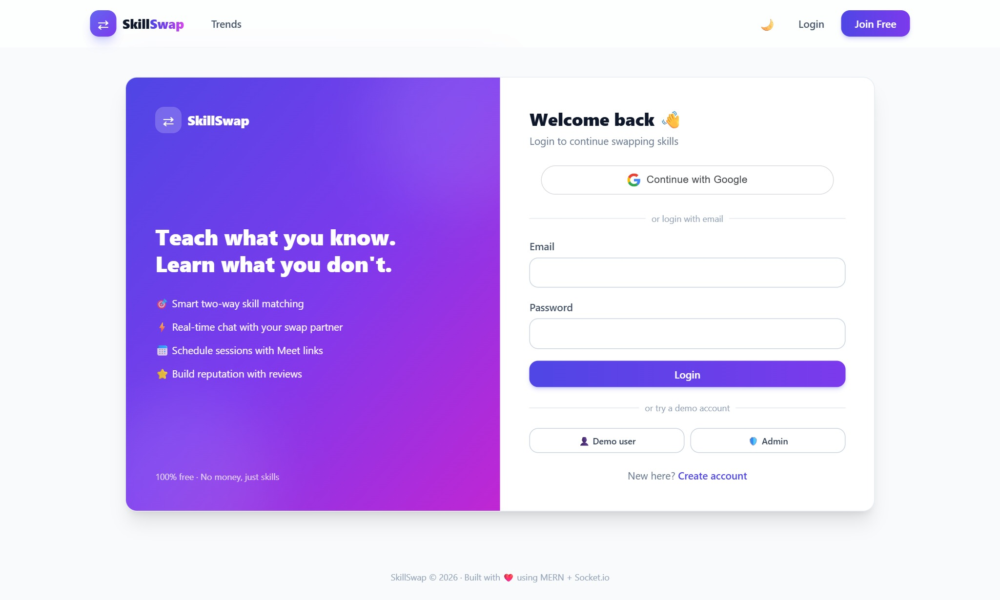 |

| 🌙 Dark mode |
|---|
| 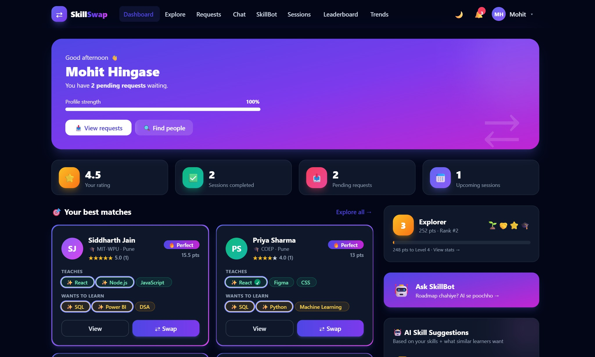 |

## 🛠️ Tech Stack

**Frontend:** React 18 (Vite) · Tailwind CSS · React Router · Axios · Recharts · Socket.io-client · WebRTC
**Backend:** Node.js · Express · MongoDB + Mongoose · Socket.io · JWT · bcrypt
**Integrations:** Google Identity Services · Google Gemini API

## 🚀 Run locally

**Requirement:** Node.js 18+. MongoDB is optional (an in-memory MongoDB with demo data starts automatically).

**Windows (one click):** double-click **`START_SKILLSWAP.bat`**

**Any OS:**
```bash
npm run setup     # first time only: installs root + server + client packages
npm run dev       # backend on :5000 + frontend on :5174
```

Open **http://localhost:5174**

| Login | Email | Password |
|---|---|---|
| Demo user | `mohit@demo.com` | `demo123` |
| Admin | `admin@skillswap.com` | `admin123` |

Other demo users: `priya@demo.com`, `rahul@demo.com`, `sneha@demo.com` … (all `demo123`).

### ⚙️ Environment (`server/.env`, all optional)

Copy `server/.env.example` to `server/.env`:

| Variable | Purpose |
|---|---|
| `MONGO_URI` | MongoDB Atlas / local URI (empty = in-memory demo DB) |
| `JWT_SECRET` | Secret for signing tokens |
| `GOOGLE_CLIENT_ID` | Enables "Continue with Google" (origin: `http://localhost:5174`) |
| `GEMINI_API_KEY`, `GEMINI_MODEL` | Enables real AI answers in SkillBot |

## 📁 Folder Structure

```
skillswap/
├── server/src/
│   ├── index.js          # Express app, Socket.io chat + WebRTC signaling
│   ├── routes.js         # REST API
│   ├── models.js         # User, SwapRequest, Session, Message, Review, Notification
│   ├── logic.js          # matching + skill suggestion algorithms
│   ├── gamification.js   # points, levels, badges, personal analytics
│   ├── quizzes.js        # skill quiz bank + grading
│   ├── ai.js             # SkillBot (Gemini + offline roadmaps)
│   ├── db.js             # MongoDB connect (Atlas or in-memory fallback)
│   └── seedData.js       # demo data
└── client/src/
    ├── pages/            # Landing, Auth, Dashboard, Explore, Chat, Sessions, SkillBot,
    │                     # Leaderboard, MyStats, Quiz, Trends, Admin, Profiles, Requests
    ├── components/       # Layout, UserCard, SwapModal, Charts, Markdown, UI
    └── context/          # AuthContext (auth + socket), CallContext (WebRTC)
```

## 🧠 Matching Algorithm

```
score = 2 × |their offered ∩ my wanted| + 2 × |my offered ∩ their wanted|
      + 5 (mutual swap bonus)
      + 0.5 × their rating
```

## 📹 How the video call works

1. Caller emits `call:invite` → partner's browser rings
2. Partner accepts → caller creates a WebRTC **offer**
3. Partner replies with an **answer**; both exchange **ICE candidates** through Socket.io
4. Audio/video then flows **directly browser-to-browser** (the server only relays signaling)

## 📄 Resume line

> **SkillSwap** — Built a MERN peer-to-peer skill exchange platform with two-way skill matching, real-time chat (Socket.io), WebRTC video calls, Google OAuth, an AI learning assistant (Gemini), quiz-based skill verification, gamification, and admin analytics with CSV export.
